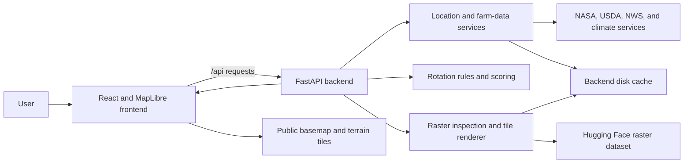
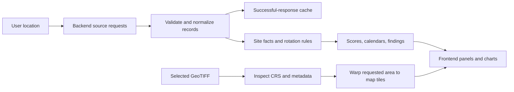

# 🌾 Farmer Helper

> **A location-based farm exploration and crop-rotation decision-support app.**

Farmer Helper brings soil, climate, weather, crop-history, and satellite information
together around a selected farm location. Users can inspect the evidence on an
interactive 3D terrain map, review a field summary, and compare possible crop
rotations.

> 🚀 **Hackathon submissions:** NASA International Space Apps Challenge · RiverHacks

**A live demo can be found here:** https://sigma-rust-three.vercel.app/

## 🧭 Contents

| | | |
| --- | --- | --- |
| [🌾 Overview](#1-overview) | [🎯 Problem and objectives](#2-problem-and-objectives) | [✨ Features](#3-features) |
| [🔄 How it works](#4-how-it-works) | [🏗️ Architecture](#5-architecture) | [🧰 Technology](#6-technology) |
| [🛰️ Data sources](#7-data-sources) | [🗂️ Data organization](#8-data-organization) | [⚙️ Installation](#9-installation) |
| [🔐 Configuration](#10-configuration) | [🚀 Run the application](#11-run-the-application) | [🗺️ Using the application](#12-using-the-application) |
| [🔬 Data processing](#13-data-processing) | [📁 Project structure](#14-project-structure) | [🧠 Technical notes](#15-technical-notes) |
| [⚡ Performance](#16-performance-and-reliability) | [⚠️ Limitations](#17-limitations) | [🌱 Future development](#18-future-development) |
| [🤝 Contributing](#19-contributing) | [📚 Acknowledgments](#20-acknowledgments-and-references) | [📬 License and contact](#21-license-and-contact) |

<a id="1-overview"></a>
## 🌱 1. Overview

| Project detail | Description |
| --- | --- |
| **Project** | Farmer Helper |
| **Category** | Agricultural decision support and geospatial data exploration |
| **Intended users** | Farmers, agricultural educators, and people exploring farm conditions |
| **Primary technologies** | Python, FastAPI, React, Vite, MapLibre GL JS |
| **Geographic focus** | Texas demo farms; several location and data services cover the US |

### 🎯 Project goals

- 📍 Make public agricultural and environmental data easier to explore by location.
- 🔎 Bring multiple sources and their limitations into a single, understandable view.
- 🌾 Help users compare crop-rotation options against available site facts and priorities.
- ✅ Keep provenance visible and avoid presenting estimates as field measurements.

<a id="2-problem-and-objectives"></a>
## 🎯 2. Problem and objectives

Information relevant to a farm is distributed across maps, agencies, and data
services. Different sources can have different dates, geographic resolutions, units,
and coverage. Comparing them can require technical tools that are not part of a
farmer's usual workflow.

Farmer Helper addresses this by organizing selected sources around a location and
presenting them in a map, data panel, and field summary. Its crop-rotation engine
uses rules and available evidence to show possible strategies, exclusions, risks,
and confidence gaps. These comparisons are starting points for discussion, not
prescriptions.

<a id="3-features"></a>
## ✨ 3. Features

- 📍 **Location-based exploration:** Select a demo farm, search a US address, enter
  coordinates, or click the map.
- 🌱 **Farm data panel:** Explore climate, soil, crop history, and related measures.
- 📊 **Field summary:** Review soil context, climate trends, satellite observations,
  weather information, and source limitations.
- 🔄 **Crop-rotation comparison:** View the current rotation and rule-based alternatives,
  with calendars, score components, benefits, risks, exclusions, and missing facts.
- 🌡️ **Climate outlook:** View a 2030–2049 model outlook when available or request one
  for a location.
- 🌦️ **Weather and alerts:** Show National Weather Service forecasts and alerts for
  supported US locations.
- 🛰️ **Raster map layers:** Inspect GeoTIFF layers, change dates, animate dated series,
  and summarize data over the visible map area. The app selects SMAP soil temperature
  in heat-diffusion layer 1 by default when that layer is available.
- 💬 **Field Q&A:** Optionally ask location-aware questions and view source links.
  Optional voice features transcribe a question and read an answer aloud.

<a id="4-how-it-works"></a>
## 🔄 4. How it works

1. **📍 Choose a location:** Select a demo farm, search an address, enter coordinates, or click the
   map.
2. **🌐 Retrieve data:** The React frontend requests location-specific information from
   the FastAPI backend.
3. **🧹 Prepare evidence:** The backend retrieves available data, reuses successful
   cached results, and reports unavailable sources independently.
4. **🧮 Compare options:** The rotation engine evaluates site facts, crop requirements,
   constraints, and user priorities to build and score strategies.
5. **🗺️ Explore results:** The frontend presents charts, a field summary, a data panel,
   and interactive map layers.

For example, a user can open the Webberwood Ranch demo, review its soil and crop
history, compare rotation alternatives, and check a weather forecast. They can then
select a dated raster layer or summarize raster values across the visible map area.

<a id="5-architecture"></a>
## 🏗️ 5. Architecture



In development, Vite forwards `/api` and `/health` requests to the backend on port
8010. Map basemap and terrain tiles are loaded directly by the browser from their
public tile services. Other farm data is retrieved by the backend.

<a id="6-technology"></a>
## 🧰 6. Technology

| Area | Technologies |
| --- | --- |
| Frontend | React, JavaScript, Vite, MapLibre GL JS, Recharts |
| Backend | Python, FastAPI, Uvicorn |
| Geospatial processing | Rasterio/GDAL, NumPy, Pillow |
| Data and configuration | JSON, CSV, GeoTIFF |
| Backend tests | pytest |
| Frontend validation | Vite production build |

<a id="7-data-sources"></a>
## 🛰️ 7. Data sources

| Information | Source | Resolution and context |
| --- | --- | --- |
| Climate normals and historical trends | [NASA POWER](https://power.larc.nasa.gov/) | Regional/modelled products; the project uses products around 50 km resolution where applicable. |
| Soil survey and profile | [USDA NRCS SSURGO](https://sdmdataaccess.sc.egov.usda.gov/) | Soil survey and map-unit information, not a field-lab measurement. |
| Crop history | [USDA NASS Cropland Data Layer](https://www.nass.usda.gov/Research_and_Science/Cropland/Release/) | Annual land-cover classification at approximately 30 m. |
| Forecasts and official alerts | [National Weather Service API](https://www.weather.gov/documentation/services-web-api) | Coverage depends on location; intended for supported US locations. |
| Future climate outlook | [Open-Meteo Climate API](https://open-meteo.com/en/docs/climate-api) | CMIP6 HighResMIP model data for 2030–2049; a projection, not a forecast. |
| Satellite water indicators | NASA GES DISC Giovanni products | Includes GPM precipitation and GRACE water indicators where available. |
| Satellite vegetation indicators | NASA MODIS products | Historical vegetation/bare-ground context where available. |
| Raster layers | [Hugging Face dataset](https://huggingface.co/datasets/OzzyWay/Farmers-Helper) | GeoTIFFs discovered from the dataset and downloaded when inspected. |
| Crop facts | [`config/crops.json`](config/crops.json) | Central Texas crop information with references recorded in the data. |
| Basemap | [OpenFreeMap](https://openfreemap.org/) and OpenStreetMap | © OpenStreetMap contributors. |
| Terrain | Mapzen Terrarium elevation tiles on AWS Open Data | Public terrain tiles used to render the 3D map. |

Crop references and raster variable names, units, valid ranges, and descriptions are
maintained with the project configuration and
[`raster_layer_catalog.csv`](raster_layer_catalog.csv). Follow each provider's
documentation for formal dataset citations and reuse terms.

<a id="8-data-organization"></a>
## 🗂️ 8. Data organization

Application configuration and data are organized as follows:

```text
config/
├── crops.json             Crop descriptions, requirements, and references
├── demo_farms.json        Demo farm coordinates
├── ndvi/                  Prepared vegetation indicator data
└── outlooks/              Precomputed climate outlooks

backend/cache/             API response caches and downloaded raster data
backend/tests/             Backend tests and test fixtures
raster_layer_catalog.csv   Raster layer metadata catalog
```

The Hugging Face dataset is discovered from repository metadata; files are organized
into dataset/family and dated series as named in that repository. The backend does
not download the whole repository at startup.

| Format | Use |
| --- | --- |
| GeoTIFF (`.tif`, `.tiff`) | Spatial raster layers |
| JSON (`.json`) | App configuration, cached results, and precomputed outlooks |
| CSV (`.csv`) | Raster metadata catalog and source data fixtures |

<a id="9-installation"></a>
## ⚙️ 9. Installation

### ✅ Prerequisites

- Python 3.11 or newer
- Node.js 20 or newer
- Git, if cloning the repository
- Network access for live upstream data

### Install on Windows

From the repository root in PowerShell:

```powershell
# Create the backend virtual environment and install pinned Python dependencies
py -3.11 -m venv backend\.venv
backend\.venv\Scripts\python.exe -m pip install -r backend\requirements.txt

# Install frontend dependencies from the lockfile
Set-Location frontend
npm.cmd ci
Set-Location ..
```

If PowerShell blocks the `npm` script, use `npm.cmd` as above. If `node` is not
found, install Node.js 20+ and reopen the terminal.

<a id="10-configuration"></a>
## 🔐 10. Configuration

Copy the example file to the repository root and add credentials only for the
optional features you want:

```powershell
Copy-Item .env.example .env
```

| Environment variable | Used for | Required to start the app? |
| --- | --- | --- |
| `EARTHDATA_TOKEN` | NASA satellite water data that requires Earthdata Login | No |
| `HF_TOKEN` | Discovering and inspecting raster layers in the Hugging Face dataset | No |
| `SERPAPI_API_KEY` | Field question-and-answer helper | No |
| `ELEVENLABS_API_KEY` | Voice transcription and read-aloud features | No |

The application starts without these keys, but the corresponding integrations may
be unavailable. Credentials are read by the backend. Never put real keys in frontend
code or commit `.env`; `.env` is ignored by Git.

For local development with GeoTIFFs, set `RASTER_DATA_DIRS` to one or more local
raster directories using the platform's path separator. The default local raster
directory is `examples/` when present.

<a id="11-run-the-application"></a>
## 🚀 11. Run the application

Start the backend and frontend in separate PowerShell terminals from the repository
root.

**Terminal 1 — backend 🐍**

```powershell
Set-Location backend
.\.venv\Scripts\python.exe -m uvicorn app.main:app --port 8010 --reload
```

**Terminal 2 — frontend ⚛️**

```powershell
Set-Location frontend
npm.cmd run dev
```

Open [http://localhost:5173](http://localhost:5173). The backend health endpoint is
[http://127.0.0.1:8010/health](http://127.0.0.1:8010/health); it should return
`{"status":"ok"}`. The Vite development server forwards API requests to port 8010.

The frontend also has `npm.cmd run build` for a production bundle. No production
hosting or deployment configuration is included in this repository.

<a id="12-using-the-application"></a>
## 🗺️ 12. Using the application

1. Choose a demo farm, search for a US street address, enter `latitude, longitude`,
   or click a point on the map.
2. Review the farm data panel and the field summary below the map.
3. Open **Map layers** to browse raster products, select a date, adjust layer
   display, or play a dated sequence. Raster discovery requires `HF_TOKEN`.
4. To calculate a regional raster summary, frame the map on the area of interest and
   choose **Summarize visible map area** in the layer panel.
5. Use the field helper if its optional service is configured; follow its source
   links and verify important advice with a trusted local expert.

The yellow map square is an estimated area about 1 km across. It is not a surveyed
field boundary.

<a id="13-data-processing"></a>
## 🔬 13. Data processing



- **Parallel retrieval:** Farm-data sources are requested concurrently. A source failure is reported
  separately and does not invalidate results from other sources.
- **Caching:** Successful upstream responses are cached under `backend/cache/`; failed responses
  are not cached as successful data.
- **Rotation analysis:** Site facts feed a rule-based engine, which creates and scores candidate
  strategies and records missing facts and exclusions.
- **Raster rendering:** Metadata is discovered first. A selected file is downloaded and inspected,
  then requested 256-pixel Web Mercator map tiles are rendered on demand.
- **Regional summaries:** NoData and pixels outside the selected area are excluded.

<a id="14-project-structure"></a>
## 📁 14. Project structure

```text
Farmers-Helpers/
├── backend/
│   ├── app/                 API, data services, rotation engine, raster processing
│   ├── tests/               Backend tests and fixtures
│   ├── scripts/             Data-building and diagnostic scripts
│   ├── cache/               Local caches (generated/runtime data)
│   ├── requirements.txt     Pinned Python dependencies
│   └── run_tests.py         Backend test runner
├── frontend/
│   ├── src/                 React UI, map, charts, and hooks
│   ├── tests/               Frontend tests
│   ├── package.json         Frontend scripts and dependencies
│   └── vite.config.js       Development server and API proxy
├── config/                  Crop, demo-farm, NDVI, and outlook data
├── raster_layer_catalog.csv Raster metadata and descriptions
├── .env.example             Optional backend credential template
└── README.md
```

<a id="15-technical-notes"></a>
## 🧠 15. Technical notes

### 🌾 Rotation analysis

The rotation engine is a rules-based system, not a machine-learning predictor. It
uses available site facts, crop requirements, farmer inputs, and optional climate
outlook data to build calendars, explain strategy fit, rank a limited number of
alternatives, and report exclusions, risks, and missing evidence.

### 🛰️ Map layers and coordinate reference systems

Raster names and measurements are matched against the project catalog. Missing CRS
information is not guessed. SMAP L4 `SPL4SMGP` rasters can use a narrowly validated
fallback when their embedded product ID, grid dimensions, and global extent match
the documented EASE-Grid 2.0 Global reference (EPSG:6933). Other inspected rasters
without a recognized CRS are omitted from the layer list for the current backend
session.

### ⚠️ Errors and missing data

Invalid locations are rejected with a user-facing message. Upstream data sources can
fail independently; the app reports unavailable data instead of treating it as a
valid measurement. Raster inspection errors are reported in the map-layer panel.

<a id="16-performance-and-reliability"></a>
## ⚡ 16. Performance and reliability

- 💾 Successful location-based API responses are cached on disk to speed up repeat
  requests and reduce upstream calls.
- 🔀 Independent data sources are fetched concurrently.
- 🧩 Raster files are downloaded only when selected; only requested map tiles are
  rendered and sent to the browser.
- 🎯 Raster requests are limited to source bounds and native resolution to avoid
  unnecessary rendering.
- ⏱️ Raster playback waits for the current map frame to load before advancing.
- 📏 The project has no published hardware benchmark or production capacity target.

<a id="17-limitations"></a>
## ⚠️ 17. Limitations

- The demo experience is centered on Texas. Geocoding and some APIs are limited to
  the United States; individual sources may cover less.
- The map square is an approximation, not a parcel boundary or legal survey.
- Data sources vary in dates, geographic coverage, units, scale, and uncertainty.
  SSURGO values can represent map units; climate values may be regional or modelled;
  CDL is a classification rather than a verified field record.
- Climate outlook values are model projections and not precise local predictions.
- Raster layers without a recognized CRS are unavailable rather than placed using an
  assumed coordinate system.
- Live data depends on upstream network services, accounts, rate limits, and
  credentials. The app may show partial results when a source is unavailable.
- Field Q&A sends the user's question and a short field-context summary to SerpApi's
  search service. Do not send sensitive information; verify answers before relying
  on them.
- Rotation comparisons are decision support, not agronomic prescriptions.

<a id="18-future-development"></a>
## 🌱 18. Future development

Potential directions—not commitments or guarantees—include expanding geographic
coverage, adding validation for additional documented raster coordinate systems,
improving accessibility and mobile map workflows, and publishing more complete data
provenance and performance evaluations.

<a id="19-contributing"></a>
## 🤝 19. Contributing

Feedback and contributions are welcome. Before opening a pull request:

1. Describe the issue or feature and its user impact.
2. Keep changes consistent with the existing module structure and style.
3. Add focused tests for new or changed behavior.
4. Run the backend tests and frontend production build.
5. Do not commit credentials, private data, or generated caches.

The repository is hosted at [github.com/OzzyWay/Farmers-Helpers](https://github.com/OzzyWay/Farmers-Helpers).
Use its issue tracker for bug reports and feature requests. Include steps to
reproduce bugs and the relevant operating system and runtime versions.

<a id="20-acknowledgments-and-references"></a>
## 📚 20. Acknowledgments and references

This project depends on data and services from NASA, USDA, the National Weather
Service, Open-Meteo, OpenStreetMap contributors, OpenFreeMap, and the Hugging Face
dataset maintainers. It also uses open-source software including React, MapLibre GL
JS, FastAPI, Rasterio/GDAL, NumPy, Pillow, and Recharts.

Useful source documentation:

- [NASA POWER](https://power.larc.nasa.gov/docs/)
- [USDA NRCS Soil Data Access](https://sdmdataaccess.sc.egov.usda.gov/)
- [USDA NASS Cropland Data Layer](https://www.nass.usda.gov/Research_and_Science/Cropland/Release/)
- [National Weather Service API](https://www.weather.gov/documentation/services-web-api)
- [Open-Meteo Climate API](https://open-meteo.com/en/docs/climate-api)
- [NASA Giovanni](https://giovanni.gsfc.nasa.gov/giovanni/)
- [NASA MODIS](https://modis.gsfc.nasa.gov/data/)
- [NSIDC SMAP L4 SPL4SMGP documentation](https://nsidc.org/data/spl4smgp/versions/7)
- [Hugging Face raster dataset](https://huggingface.co/datasets/OzzyWay/Farmers-Helper)
- [OpenStreetMap copyright and attribution](https://www.openstreetmap.org/copyright)

Consult original provider documentation for required attribution and dataset
citations when reusing their data.

<a id="21-license-and-contact"></a>
## 📬 21. License and contact

There is currently no `LICENSE` file in the repository. No project reuse or
redistribution license should be inferred; third-party datasets and software may
also have their own terms.

For questions, bug reports, or collaboration, use the
[project's GitHub repository](https://github.com/OzzyWay/Farmers-Helpers) and its
issue tracker.
